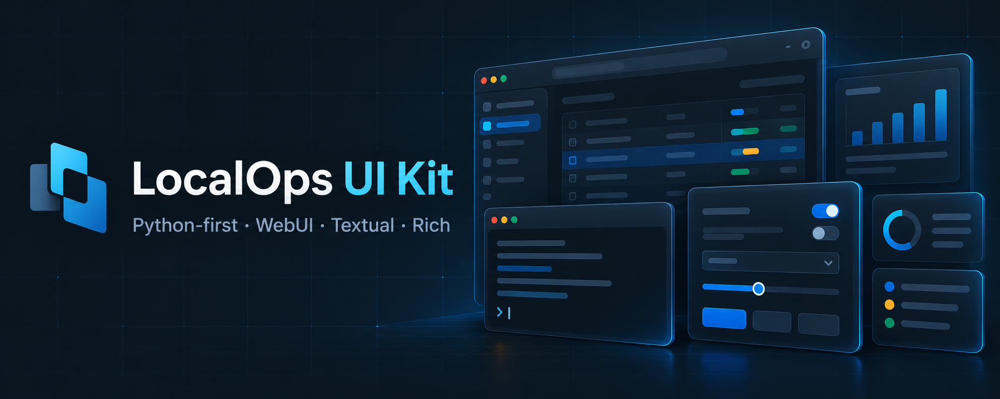

# LocalOps UI Kit



[](#installation) [](LICENSE) [](https://github.com/unixwzrd/localops-ui-kit/actions/workflows/ci.yml) [](CHANGELOG.md) [](#installation) [](https://unixwzrd.ai/localops-ui-kit/)

LocalOps UI Kit is a Python-first presentation toolkit for local-first operator tools. Compose native browser widgets directly, or define typed Python screens for WebUI, Textual and Rich within their documented capabilities. The browser implementation is ordinary JavaScript ES modules and CSS, served unchanged by Python or any static host. No frontend framework, JavaScript package manager, compiler or bundler is required.

## Why LocalOps UI Kit?

Local tools repeatedly need the same presentation pieces: tables, forms, task logs, document readers, dialogs and responsive navigation. Rebuilding those separately for each project duplicates accessibility work, layout fixes and browser tests. This toolkit gives those pieces one reusable home while leaving application behavior where it belongs.

The particular combination matters: Python owns typed specifications and interchange contracts; native browser modules provide the primary interface without a frontend build; and applications can adopt individual widgets without replacing their backend or command-line tools. Textual and Rich make shared concepts accessible in terminal environments, with explicit fallbacks rather than a promise that every browser interaction can be reproduced in a terminal.

This is not an attempt to replace every UI framework or supply a complete application platform. There is no bundled FastAPI server, router, authentication system, job executor or process supervisor. Consumers supply data and authorized behavior through adapters and callbacks. A future application host could be built around that boundary, but it is not required to use the widgets and is not part of this release.

## Installation

Python **3.12 or newer** and Git are required for a Git-based install. Once the repository is public, no GitHub account, token or PyPI release is needed. The recommended release target is the exact, lowercase tag **`v0.2.0`**:

```bash
python -m pip install "localops-ui @ git+https://github.com/unixwzrd/localops-ui-kit.git@v0.2.0"
```

For the optional Rich CLI and Textual TUI renderers:

```bash
python -m pip install "localops-ui[all] @ git+https://github.com/unixwzrd/localops-ui-kit.git@v0.2.0"
```

Use `[cli]` or `[tui]` instead of `[all]` when only one terminal renderer is needed. Release commands require that `v0.2.0` has been created and pushed after final qualification. For locked application dependencies, pin the full commit identified by the reviewed release tag. Published release tags should not be moved to different commits.

### Development version

To try the latest work instead of the release, explicitly select `main`:

```bash
python -m pip install "localops-ui @ git+https://github.com/unixwzrd/localops-ui-kit.git@main"
```

`main` moves as development proceeds. A passing main-branch CI badge is not a claim that every commit is a qualified release; use the release tag or its commit pin for application dependencies.

### Browser test kit

The optional browser/layout test kit is a separate package in this repository. It can be installed from the same repository release tag even though its own package version is 0.1.0:

```bash
python -m pip install "localops-ui-testkit @ git+https://github.com/unixwzrd/localops-ui-kit.git@v0.2.0#subdirectory=packages/python-testkit"
```

These commands use [pip's supported VCS installation syntax](https://pip.pypa.io/en/stable/topics/vcs-support/). Python builds and installs the package; its native JavaScript/CSS assets are included unchanged. Node/npm is not required. Installing the toolkit does not start a server or application. The test kit does not install browser binaries automatically. Neither package is published to PyPI; `pip install localops-ui` alone is not the documented installation path.

## Widgets, documentation and demo

Version **0.2.0** is a public-preview preparation release. Start with the [widget and control guide](docs/widget-guide.md), grouped by layout/navigation, actions/states, forms, dialogs/content, data/tasks and integration helpers. Every public browser export is documented, including its callbacks and limitations. See also the [adoption guide](docs/adoption-guide.md), [renderer capability matrix](docs/capability-matrix.md) and [changelog](CHANGELOG.md).

### Standalone demo

The gallery runs by itself from a source checkout; it needs only Python's standard library and a browser, not FastAPI or an application backend. From the repository root:

```bash
python scripts/build_showcase.py
python -m http.server 8765 --bind 127.0.0.1 --directory _site
```

Open `http://127.0.0.1:8765/`, or try the [live widget showcase](https://unixwzrd.ai/localops-ui-kit/). Stop the local server with Ctrl+C. The builder refuses to overwrite an existing output directory; for another build, choose a fresh directory with `--output` and serve that directory instead.

The showcase links controls, tables, tasks, dialogs, the draft editor, content panels and results reader. Path, task and preference adapters use synthetic, in-memory data: demo actions do not execute shell commands or operate on your filesystem. GitHub Pages, Jekyll or another static host can serve the same files with no Python service at runtime. The gallery source is not installed as a standalone application command by the wheel; installing the package alone does not launch a UI. See [deployment and privacy gates](docs/public-release.md).

## Repository layout

- `packages/web/`: framework-free browser JavaScript and CSS
- `packages/python/`: `localops-ui` semantic models and WebUI, Textual, and Rich renderers
- `packages/python-testkit/`: `localops-ui-testkit` Python package
- `examples/component-gallery/`: development and visual-test harness
- `examples/showcase/`: public demo index, grouped by widget purpose
- `tests/`: browser and component tests
- `docs/`: architecture, provenance inventory, and adoption guidance

See the [changelog](CHANGELOG.md) for component history and the [widget guide](docs/widget-guide.md) for current APIs and limitations.

## Build and test

```bash
python -m pip install -e '.[all,test]'
python -m pip install -e 'packages/python-testkit[test]'
python -m playwright install chromium webkit
ruff format --check packages/python packages/python-testkit tests scripts
ruff check packages/python packages/python-testkit tests scripts
python scripts/validate_assets.py
python scripts/check_publication.py
pytest packages/python/tests packages/python-testkit/tests tests --browser chromium --browser webkit
python -m build
python -m build --outdir packages/python-testkit/dist packages/python-testkit
python scripts/verify_distribution.py
```

Canonical JavaScript and CSS live in `packages/web/static/` and are included unchanged in the Python wheel. The separate wheel and sdist commands keep the external canonical asset path explicit. Neither package is published to npm or PyPI.

## Python-first UI definition

```python
from localops_ui.gallery import operator_workspace_snapshot
from localops_ui.renderers.rich import run_cli_sync

snapshot = operator_workspace_snapshot()
run_cli_sync(snapshot, interactive=False)
```

Install `localops-ui[cli]`, `localops-ui[tui]`, or `localops-ui[all]` according to the required backends. JSON is a versioned interchange format; typed Python models remain authoritative.

## Python loopback mounting

Ship the canonical files from `packages/web/static/` with the Python application or install them from the wheel's `localops_ui/static/` resources. A Python build copies those bytes into the wheel as package data; it does not execute JavaScript tooling. A production deployment needs only a static-file server and a browser.

For a minimal loopback development server:

```python
from functools import partial
from http.server import SimpleHTTPRequestHandler, ThreadingHTTPServer
from importlib.resources import as_file

from localops_ui import web_assets

with as_file(web_assets()) as assets:
    handler = partial(SimpleHTTPRequestHandler, directory=assets)
    ThreadingHTTPServer(("127.0.0.1", 8765), handler).serve_forever()
```

Mount `index.js`, its JavaScript module siblings, and `styles.css` through the application's own static-file mechanism. Applications may construct adapters in JavaScript or provide a Python-authored `UISnapshot` through `ManifestRuntime`. The consumer owns transport and URLs in both cases; each event reply carries a closed `UITransportResponse` with an advancing snapshot or patch plus any command result.

See [the adoption guide](docs/adoption-guide.md) for an adapter example and consumer sequence.

## Release privacy

Local agent/consumer handoffs stay in the private development workspace and are excluded from public history, distributions and demo assembly. Reviewed source changes are promoted into a separate public Git history; private ancestry is never merged or mirror-pushed into it. See the [development-to-public workflow](docs/public-release.md#development-to-public-workflow). Export/build tools never commit, push, change visibility or publish packages themselves.

## Contributing

Issues and pull requests are welcome for:

- framework-independent components and adapters
- accessibility and keyboard interaction improvements
- responsive operator layouts
- browser-testing and layout-oracle coverage
- documentation and adoption examples

Before submitting a change, run the Python-authoritative checks documented in [Build and test](#build-and-test). Keep domain-specific interpretation, backend routes, and consumer lifecycle assumptions outside this repository.

## Support This Work

If LocalOps UI Kit saves you time or helps you build better local-first operator tools, consider supporting independent development:

- [Patreon](https://patreon.com/unixwzrd)
- [Ko-Fi](https://ko-fi.com/unixwzrd)
- [Buy Me a Coffee](https://buymeacoffee.com/unixwzrd)

Quite a bit of effort goes into designing, testing, documenting, and preparing reusable releases. One coffee means one more tool gets released into the wild.

Thank you for keeping solo development alive.

## License

Copyright 2026<br>
[info@unixwzrd.ai](mailto:info@unixwzrd.ai)

[MIT License](LICENSE)

Permission is hereby granted, free of charge, to any person obtaining a copy of this software and associated documentation files (the "Software"), to deal in the Software without restriction, including without limitation the rights to use, copy, modify, merge, publish, distribute, sublicense, and/or sell copies of the Software, and to permit persons to whom the Software is furnished to do so, subject to the following conditions:

The above copyright notice and this permission notice shall be included in all copies or substantial portions of the Software.
