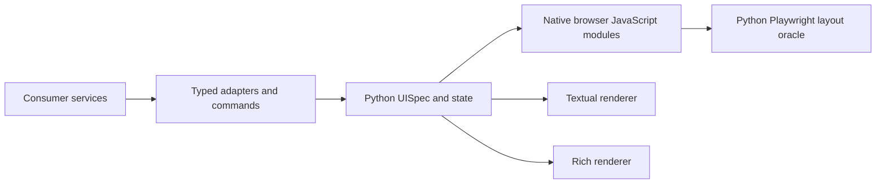

# Architecture

## Boundaries

LocalOps UI Kit owns semantic UI contracts, WebUI/Textual/Rich presentation, interaction behavior, accessibility mechanics, and rendered-layout verification. A consuming application owns transport, authorization, domain interpretation, persisted domain models, and operational commands.

Python is the authoritative UI authoring language. Strict Pydantic specifications may be serialized as JSON and rendered by any supported backend. The web package is authored directly as standards-based JavaScript ES modules, with JSDoc where type documentation materially improves the public contract. CSS is a standalone asset based on custom-property tokens. The canonical browser files are served directly during development and included unchanged in Python distributions. There is no application framework, transpiler, bundler, npm install, or Node dependency in development, packaging, installation, or production.

The completed migration and its acceptance gates are recorded in [the native JavaScript migration plan](native-javascript-migration-plan.md). The pre-migration export and test mapping is retained in [the migration baseline](migration-baseline.md).

## Public contracts

- `PathAdapter` resolves, browses, or creates a consumer-defined path. The path component does not know routes or filesystem policy.
- `TaskAdapter` supplies snapshots. Optional streaming, cancel, and retry capabilities are represented by the separate `TaskSubscriptionAdapter`, `TaskCancelAdapter`, and `TaskRetryAdapter` protocols so a snapshot-only adapter is typed accurately. The monitor uses neutral task phases.
- `PreferenceStore<T>` persists component-owned layouts through a consumer-selected medium.
- `ArtifactProvider` lists and opens backend-described artifacts without defining their meaning.

All backend-derived state is rendered as supplied. The web package does not calculate severity, validity, acceptance, metric meaning, or task outcome.

## Component construction

`ContentPanel` is a direct modal surface for consumer-trusted DOM or literal text. It uses the browser's native dialog top layer/inertness, explicit focus containment/recovery and existing toolkit controls/tokens. Expansion changes geometry while retaining child nodes. The toolkit performs no parsing, lookup, routing or semantic interpretation. Its `{open,expanded}` presentation snapshot has a strict Python `ContentPanelState`; no manifest node is added.

Components return DOM roots or small controller objects. Consumers append roots to their document and retain controllers only when they need imperative updates or cleanup. The API uses platform types (`HTMLElement`, `Node`, `Promise`, `Intl`) and documented JavaScript option shapes rather than framework lifecycle hooks. Runtime validation is used at public JSON and adapter boundaries where malformed external data would otherwise produce ambiguous failures.

Dialogs implement a modal focus boundary, initial focus, Escape handling, and focus restoration. Tabs implement stable generated relationships, managed `tabindex`, and the standard arrow/Home/End keyboard model.

## Python specification and state

The shell retains its DOM-root return contract and exposes `closeNavigation({focusTarget?})` on that root. Consumers invoke it explicitly after accepted navigation. It keeps the drawer expansion state synchronized and moves focus out of hidden mobile navigation to a validated destination or the main pane. Desktop navigation and passive updates retain their existing behavior. No route, backend call or domain interpretation is added.

Public and persisted objects are closed, strict Pydantic models. Their JSON state is detached and recursively immutable after validation. Internal renderer plans are frozen dataclasses. Stable, non-empty IDs bind components to state, commands, data providers, and adapters without serializing callables. `UISnapshot` and `StatePatch` use monotonic revisions; stale updates fail rather than silently overwriting newer state. Every accepted event produces a closed `UITransportResponse` containing an advancing snapshot or patch plus any command result.

The internal `LayoutCompiler` provides the useful behavior of a packer while the public API remains an explicit immutable tree. Each renderer declares native, fallback, or unsupported component capabilities before rendering.

## Direct results/reader presentation

`ResultReader` is an additive browser controller composed with the operator shell. Its strict Python contracts live in `localops_ui.result_reader` and are separate from `UISnapshot`. Passive `setSnapshot` updates enforce monotonic revisions and selected-result ownership. Document identity plus `contentRevision` govern DOM/scroll preservation; deliberate `revealBlock` navigation validates the current document/content/block identity without changing content revisions or focus by default. The application owns obsolete-load cancellation. No manifest node or dedicated terminal controller is added by this API; terminal composition capabilities are documented separately. See the adoption guide for exact shapes and mounting.

## Direct draft editing

`CodeEditor` is a native textarea controller with a measured line gutter, independent of the manifest schema. Strict Python direct-component contracts live in `localops_ui.code_editor`. The consumer supplies normalized LF text and owns original newline metadata, source authorization and draft collection policy. Same-document revisions advance; dirty baseline replacement requires an explicit consumer decision. Undo/redo stores bounded before/after transactions, including native input and programmatic changes; completed composition is a single transaction. Copy/export are injected intents. No transport, filesystem, persistence or analytical interpretation is introduced. Details and limits are in the adoption guide.

## Data table persistence

The table persists a closed `DataTableLayout` containing column order, visible column IDs, and widths. Malformed preferences are ignored with an explicit operator-visible state while the default table remains usable. Sorting is disabled by default: applications either provide `onSort` for backend-owned semantics or explicitly enable client sorting with a declared locale. Widths can be changed with pointer drag or keyboard arrows; order can be changed with drag-and-drop or explicit move controls.

## Layout oracle

`localops-ui-testkit` evaluates rendered geometry in a real Playwright page. It reports document and pane overflow, fixed/sticky overlay occlusion, center and inset hit failures, clipped labels, permanent parent clipping, reachability after `scrollIntoView`, open modal roots, and background controls that remain operable behind an undersized or ineffective modal overlay. Internal selector configuration is a dataclass; public and persisted reports are closed, strict Pydantic models with bounded JSON details.

The oracle is domain-neutral. Consumers mark governed scroll panes with `data-layout-pane` and may mark additional labels with `data-layout-label`.

## Security and packaging

The toolkit has no request client and embeds no backend URLs. Callback implementations remain within the consumer's authority boundary. Canonical browser assets live under `packages/web/static/`; the Python wheel includes those files as `localops_ui/static/` package data without rewriting them. Build artifacts contain no environment paths and can be copied into a wheel, application bundle, or other static asset package.

Python 3.12 is the build and test authority. Browser interaction and rendered-geometry checks use Python Playwright. Browser module loading provides JavaScript syntax and import validation, while focused Python checks enforce asset manifests, relative imports, domain-boundary scans, and the absence of absolute developer paths.
